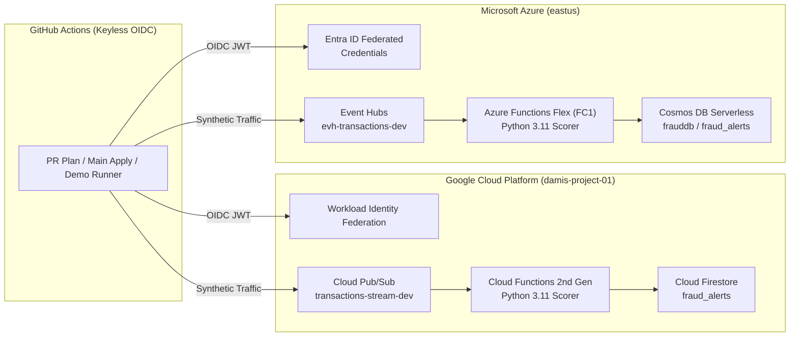

# Real-Time Multicloud Fraud Detection Pipeline

Event-driven, serverless fraud detection pipeline provisioned across **Google Cloud Platform (GCP)** and **Microsoft Azure** using **Terraform** and **GitHub Actions** CI/CD.

## Architecture Comparison

| Pipeline Layer | Google Cloud Platform (GCP) | Microsoft Azure |
| :--- | :--- | :--- |
| **Event Ingestion** | Cloud Pub/Sub (`transactions-topic`) | Azure Event Hubs (`evh-transactions-dev`) |
| **Serverless Compute** | Cloud Functions 2nd Gen (Python 3.11) | Azure Functions Flex Consumption `FC1` (Python 3.11) |
| **Operational Storage** | Cloud Firestore (Native Mode) | Azure Cosmos DB Serverless (`frauddb` / `fraud_alerts`) |
| **Observability & Alerting** | Cloud Monitoring Alert Policy | Application Insights + Azure Monitor (`exceptions/count > 0`) |
| **IaC & CI/CD** | Terraform + GitHub Actions (`apply-gcp`) | Terraform (`azurerm` v4) + GitHub Actions (`apply-azure`) |

## Repository Structure

```text
├── .github/workflows/   # PR plan checks and main-branch Terraform apply workflows
├── bootstrap/           # Remote state storage bootstrap (GCS & Azure Storage)
├── infra/
│   ├── gcp/             # GCP Pub/Sub, Cloud Functions, Firestore, and Monitoring IaC
│   └── azure/           # Azure Event Hubs, Flex Consumption Function, Cosmos DB, and Alerts IaC
└── src/
    ├── generator/       # Synthetic transaction producer
    ├── scorer/          # GCP Cloud Function fraud scoring logic
    └── azure_scorer/    # Azure Function Event Hub trigger & Cosmos DB writer
```

## Fraud Scoring Rules & End-to-End Verification

Incoming JSON transaction payloads are evaluated in real time against three deterministic risk rules:
- **High Amount (`HIGH_AMOUNT_OVER_5000`):** Transaction amount exceeds `$5,000.00`.
- **International Velocity (`INTERNATIONAL_VELOCITY_THRESHOLD`):** Cross-border flag (`is_international: true`).
- **High-Risk Merchant (`HIGH_RISK_CATEGORY`):** Merchant category in high-risk list (such as `crypto_exchange`).

Verified end-to-end across both cloud pipelines using synthetic test payload `tx-fraud-001` (`$8,500.00`, `crypto_exchange`, `is_international: true`), confirming sub-second scoring and persisted fraud alert records in both Cloud Firestore and Azure Cosmos DB.

## End-to-End Event & Keyless OIDC Architecture



## One-Click Employer Demo & Teardown

1. **Provision Dual-Cloud Infrastructure:** Open **Actions $\rightarrow$ Terraform Apply Main $\rightarrow$ Run workflow** (or push to `main`).
2. **Stream Synthetic Fraud Traffic:** Open **Actions $\rightarrow$ One-Click Employer Demo & Traffic Generator $\rightarrow$ Run workflow**, choose `both` clouds and `10` transactions, and verify scored high-risk alerts in **Cloud Firestore** and **Azure Cosmos DB**.
3. **Clean Teardown:** Re-run **One-Click Employer Demo & Traffic Generator** with `teardown_after_demo: true` to destroy all billable GCP and Azure resources while preserving remote Terraform state.